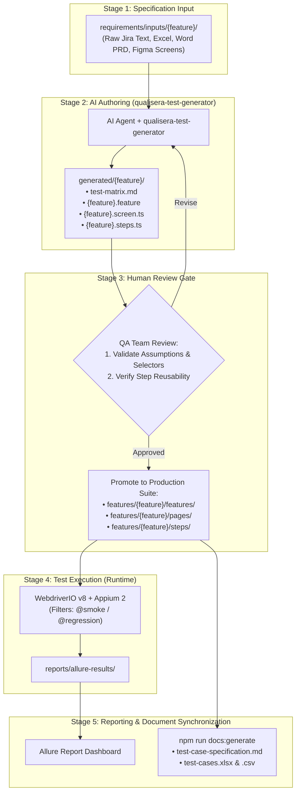

# Qualisera Mobile Automation Framework 🚀

Enterprise-Grade, Agentic Mobile Test Automation Boilerplate built using **WebdriverIO v8**, **Appium 2**, **Cucumber BDD**, **TypeScript**, **Allure Reports**, and a **Dedicated Manual QA Execution Dashboard**.

Designed for seamless shift-left QA with AI Agent integration (`qualisera-test-generator` and `app-quality-advisor`).

---

## ⚡ Quick Start (4 Easy Steps)

```bash
# 1. Clone your project / template
git clone <your-repo-url>.git
cd qualisera-automation

# 2. Install dependencies & configure environment
npm install
cp .env.example .env

# 3. Place your target mobile application binary in apps/
# e.g. save as apps/app.apk (and update ANDROID_APP_PATH in .env)

# 4. Ensure an Android Emulator is running, then run the smoke tests:
adb devices  # Ensure emulator is detected
npm run test:smoke
```

---

## 📑 Table of Contents
1. [Architecture & Test Lifecycle (BDD + AI Skills)](#-architecture--test-lifecycle-bdd--ai-skills)
   - [End-to-End Workflow: From Requirement to Running Test](#-end-to-end-workflow-from-requirement-to-running-test)
2. [Test Suite Structure](#-test-suite-structure)
3. [Test Tag Taxonomy](#-test-tag-taxonomy)
4. [Project Directory Structure](#-project-directory-structure)
5. [Running Tests](#-running-tests)
6. [Manual QA Execution Dashboard](#-manual-qa-execution-dashboard)
7. [Automated Documentation (Single Source of Truth)](#-automated-documentation-single-source-of-truth)
8. [Interactive Reporting (Allure Report)](#-interactive-reporting-allure-report)
9. [AI Skill Integration Guide](#-ai-skill-integration-guide)

---

## 🔄 Architecture & Test Lifecycle (BDD + AI Skills)



---

## 🧭 End-to-End Workflow: From Requirement to Running Test

| # | Step | What you do | Output |
| :-: | :--- | :--- | :--- |
| **0** | **Setup (once)** | `npm install`, `cp .env.example .env`, put app binary in `apps/`, start an emulator (`adb devices`), run `npm run test:smoke` | Working environment |
| **1** | **Gather inputs (Frictionless)** | Put any raw requirement files in `requirements/inputs/{feature}/` (Jira notes `.txt`, Excel `.xlsx/.csv`, Word `.docx`, PDF, Figma screenshots `.png`) | Raw inputs in folder |
| **2** | **Requirement Normalization** | Prompt the agent: *"Design tests from requirements/inputs/{feature}"*. The agent asks questions **one by one** if ambiguous, extracts ACs, and normalizes into `requirements/{feature}.md` | Normalized PRD & Q&A |
| **3** | **Prompt the agent** | Use the template in [docs/qa-prompt-guide.md](docs/qa-prompt-guide.md) (include manual test cases for reconciliation) | Requirement analysis + open questions |
| **4** | **Review the matrix** | Answer open questions, correct assumptions, approve the coverage matrix | Approved plan |
| **5** | **Draft generated** | Agent writes `generated/{feature}/` (matrix, feature, screen, steps) | Draft files in staging |
| **6** | **Human gate** | Verify selectors against the real app (`adb shell uiautomator dump` or Appium Inspector), tags, step reuse | Validated draft |
| **7** | **Promote** | Move files into `features/{feature}/`, fix imports, add `test:feature:{feature}` to `package.json` | Production suite |
| **8** | **Run automated tests** | `npm run typecheck`, `npm run lint:tags`, `npm run test:feature:{feature}`, `npm run test:smoke`, `npm run report` | Allure report |
| **8b** | **Execute manual tests** | For scenarios tagged with `@manual`, run `npm run test:manual:dashboard` (Web UI to set Pass/Fail/Blocked, link Jira bugs, and attach screenshot evidence) | `reports/manual-results/` |
| **9** | **Sync docs** | `npm run docs:generate` | Updated spec, CSV and XLSX |

---

## 🏷️ Test Tag Taxonomy

| Category | Tag | Description & Usage Example |
| :--- | :--- | :--- |
| **Traceability** | `@REQ-<KEY>` | Maps scenarios directly to requirement documentation |
| | `@AC-xx` | Maps scenario to an Acceptance Criterion (e.g. `@AC-01`) |
| | `@JIRA-<KEY>` | Maps scenario to its Jira issue (e.g. `@JIRA-PROJ-101`) |
| **Execution** | `@automated` | Scenarios executed by Appium runner |
| | `@manual` | Manual verification scenarios (executed via `npm run test:manual:dashboard`) |
| **Priority** | `@smoke` | P0 critical application path, must pass before release |
| | `@regression` | Full comprehensive regression test suite (P1/P2) |
| **Risk Level** | `@p0` | Critical path. Always paired with `@smoke` |
| | `@p1` | Main regression flows. Always paired with `@regression` |
| | `@p2` | Edge-case / stress. Always paired with `@regression` |
| **Platform** | `@android`, `@ios`, `@web` | Target platform |

---

## 📋 Manual QA Execution Dashboard

Scenarios tagged with `@manual` (hardware camera scan, biometrics, SMS OTP, visual exploratory checks) are excluded from automated test runners. QA can execute and track manual verification using the built-in local dashboard:

```bash
npm run test:manual:dashboard
```

Open `http://localhost:3000` in your browser:
* **Live SSoT Sync:** Reads all `@manual` scenarios directly from `features/**/*.feature`.
* **Execution Statuses:** Update status to 🟢 `PASSED`, 🔴 `FAILED`, 🟡 `BLOCKED`, or ⚪ `NOT_EXECUTED`.
* **Jira Bug Linkage:** Input bug ticket links directly on failed scenarios.
* **Evidence Upload:** Upload screenshot attachments or paste evidence from clipboard. Evidence is persisted in `reports/manual-results/evidence/`.
* **Session Persistence:** Click **Save All Results** to export execution data to `reports/manual-results/manual-execution-results.json`.

---

## 📁 Project Directory Structure

```text
qualisera-automation/
├── .agents/skills/            # Agentic AI Skills (qualisera-test-generator, app-quality-advisor)
├── apps/                      # Binary storage (.apk, .ipa)
├── docs/                      # Automated specifications, RTM (docs:generate), prompt guides
├── features/                  # Production BDD test suites by domain
│   └── sample/
│       ├── features/          # Gherkin feature files
│       ├── pages/             # Page/Screen Objects (POM)
│       └── steps/             # Step Definitions
├── generated/                 # AI Staging area (Drafts before promotion gate)
├── reports/                   # Allure and manual execution results
├── requirements/              # Input gateway for specifications
│   ├── _template.md           # PRD template
│   └── inputs/                # Raw user inputs (txt, xlsx, docx, png)
├── scripts/                   # Tooling (lint-tags, generate-docs, manual-dashboard)
├── shared/                    # Core framework (BaseScreen, common steps, i18n, configs)
├── wdio.android.conf.ts       # Android Appium capability configuration
└── wdio.shared.conf.ts        # Shared WebdriverIO runtime configuration
```

---

## 🚀 Running Tests

```bash
# Run all automated tests
npm run test:android

# Run smoke tests only (@smoke and not @manual)
npm run test:smoke

# Run regression tests only (@regression and not @manual)
npm run test:regression

# Run specific feature module
npm run test:feature:sample

# Launch Manual QA Dashboard
npm run test:manual:dashboard

# Validate tag taxonomy
npm run lint:tags

# Typecheck TypeScript
npm run typecheck

# Synchronize documentation and RTM
npm run docs:generate

# Generate and open Allure report
npm run report
```

---

## 📄 License
MIT License.
