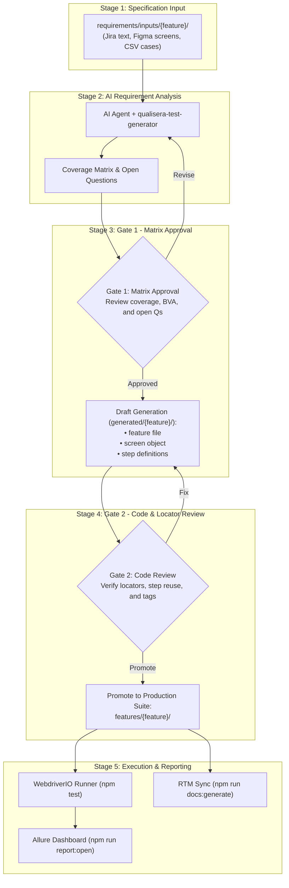

# Qualisera Multi-Platform Test Automation Framework 🚀

Test automation boilerplate for **Android**, **Web**, and **iOS**, combining **WebdriverIO v8**, **Appium 2**, **Cucumber BDD**, **TypeScript**, **Allure Reporting**, and an interactive **Manual QA Dashboard**.

Designed for AI-assisted test authoring with vendor-agnostic repository skills (`qualisera-test-generator` and `app-quality-advisor`).

> [!TIP]
> 🤖 **New to AI-Assisted QA?** Refer to the **[QA Prompting Guide](docs/qa-prompt-guide.md)** for dual-language prompt templates (Indonesian & English), worked examples, approval workflows, and tag cheatsheets. Prompts can be submitted in either Indonesian or English.

---

## 📱 Platform Support & Readiness

| Platform | Engine | Status | Notes |
| :--- | :--- | :---: | :--- |
| **Website** | WebdriverIO (Chrome) | 🟢 Ready | Fully supported for desktop and mobile web browser testing. |
| **Android** | Appium 2 (UiAutomator2) | 🟢 Stable | Fully supported out-of-the-box for native APKs on emulators and devices. |
| **iOS** | Appium 2 (XCUITest) | 🟡 Template | Configuration template provided; requires macOS and Xcode environment. |

---

## 📋 Prerequisites

Ensure your development machine has the following tools installed and environment variables configured before running tests:

| Tool / Dependency | Required Version | Verification Command | Notes & Environment Variables |
| :--- | :--- | :--- | :--- |
| **Node.js** | `>= 20.0.0` | `node -v` | Active LTS recommended |
| **JDK (Java)** | `17+` | `java -version` | Ensure `JAVA_HOME` is set: `echo $JAVA_HOME` |
| **Android SDK** | API Level `30+` | `adb --version` | Ensure `ANDROID_HOME` or `ANDROID_SDK_ROOT` is exported |
| **Android Virtual Device (AVD)** | Android 11.0+ | `adb devices` | Start an emulator via Android Studio Device Manager |
| **Google Chrome** | Latest Stable | Open Chrome browser | Required for Web test execution |
| **Appium 2 Driver** | UiAutomator2 | `npx appium driver list` | Install via `npm run appium:setup` |
| **Xcode** *(macOS only)* | `15+` | `xcodebuild -version` | Only required if running iOS suites |

---

## ⚡ Quick Start

```bash
# 1. Clone this repository template and enter the directory
git clone <your-repo-url>.git qualisera-automation
cd qualisera-automation

# 2. Install dependencies & initialize configuration
npm install
cp .env.example .env

# 3. Setup Appium UiAutomator2 driver (one-time setup)
npm run appium:setup

# 4. Place your target Android application binary in apps/
# Save APK as apps/app.apk (and verify ANDROID_APP_PATH="./apps/app.apk" in .env)
# (features/sample is an architectural smoke suite verifying target app readiness)

# 5. Ensure an Android Emulator or device is detected
adb devices

# 6. Run the Android Smoke Suite
npm run test:smoke
```

> [!NOTE]
> **Appium Server Lifecycle**: WebdriverIO manages the Appium server connection automatically when configured with `@wdio/appium-service` in the runner config. Alternatively, you can run a standalone server anytime via `npx appium` on port `4723`.

### Expected Terminal Output (Sample):
```text
[0-0] RUNNING in Android - /features/sample/features/sample.feature
[0-0] PASSED in Android - /features/sample/features/sample.feature

Spec Files:     1 passed, 1 total (100% completed)
Execution Time: ~12s
Output:         Results written to reports/allure-results/
```

---

## 📑 Table of Contents
1. [Architecture & Workflow](#architecture--workflow)
2. [End-to-End Workflow Table](#end-to-end-workflow-table)
3. [Environment Configuration (.env)](#environment-configuration-env)
4. [Test Tag Taxonomy](#test-tag-taxonomy)
5. [Running Tests & Reports](#running-tests--reports)
6. [Manual QA Execution Dashboard](#manual-qa-execution-dashboard)
7. [Automated Documentation & RTM](#automated-documentation--rtm)
8. [Email Reporting & Setup Wizard](#email-reporting--setup-wizard)
9. [Troubleshooting & FAQ](#troubleshooting--faq)
10. [Project Directory Structure](#project-directory-structure)

---

## Architecture & Workflow

The framework enforces two human approval gates to ensure that AI generates high-quality, verified tests:



---

## End-to-End Workflow Table

| # | Step | Description | Primary Output |
| :-: | :--- | :--- | :--- |
| **1** | **Gather Inputs** | Place raw Jira ticket notes, Figma screenshots, or manual case exports into `requirements/inputs/{feature}/`. | Raw files ready in staging |
| **2** | **AI Requirement Analysis** | Send prompt from [docs/qa-prompt-guide.md](docs/qa-prompt-guide.md). The AI enumerates positive/negative/BVA cases and lists open questions. | Test matrix & clarifying questions |
| **3** | **Gate 1: Matrix Approval** | Review the coverage matrix, answer clarifying questions, and reply **`Approved`** (or **`Setuju`**). | Scope and business logic confirmed |
| **4** | **Draft Code Generation** | The AI writes Cucumber feature files, Screen Objects, and step definitions into safe staging folder `generated/{feature}/`. | Working draft code in staging |
| **5** | **Gate 2: Locator Verification** | Verify element selectors against real app using Appium Inspector, `adb shell uiautomator dump`, or browser DevTools. | Verified locators |
| **6** | **Promotion to Production** | Move files from `generated/{feature}/` into official test suite `features/{feature}/`. | Production test suite |
| **7** | **Static Quality Gate** | Run tag linter and TypeScript compiler checks: `npm run lint:tags && npm run typecheck`. | Verified compilation & tags |
| **8** | **Automated Execution** | Execute automated test runs: `npm run test:smoke` or `npm run test:regression`. | Test execution results |
| **9** | **Manual Verification** | For hardware/biometric tests tagged `@manual`, record results in `npm run test:manual:dashboard`. | `manual-execution-results.json` |
| **10** | **Documentation Sync** | Generate Requirements Traceability Matrix (RTM): `npm run docs:generate`. | Markdown, CSV, and XLSX specs |

---

## Environment Configuration (.env)

All runtime parameters are configured through `.env`. Use `.env.example` as your template:

| Category | Key | Required | Default / Example | Purpose |
| :--- | :--- | :---: | :--- | :--- |
| **Web** | `WEB_BASE_URL` | Optional | `https://example.com` | Base URL for Web browser automation |
| | `WEB_BROWSER` | Optional | `chrome` | Target browser for web execution |
| | `HEADLESS` | Optional | `true` | Toggle headless mode (`false` shows visual browser) |
| **Android** | `ANDROID_APP_PATH` | For Mobile | `./apps/app.apk` | Path to target Android APK file |
| | `ANDROID_DEVICE_NAME` | For Mobile | `Android Emulator` | Name of active emulator or physical device |
| | `ANDROID_PLATFORM_VERSION` | For Mobile | `14.0` | Target Android OS version |
| | `ANDROID_AUTOMATION_NAME` | For Mobile | `UiAutomator2` | Appium automation driver name |
| **iOS** | `IOS_APP_PATH` | For iOS | `./apps/app.ipa` | Path to target iOS binary |
| | `IOS_DEVICE_NAME` | For iOS | `iPhone 15 Pro` | Target iOS simulator device name |
| | `IOS_PLATFORM_VERSION` | For iOS | `17.0` | Target iOS version |
| | `IOS_AUTOMATION_NAME` | For iOS | `XCUITest` | Appium iOS driver name |
| **Credentials** | `TEST_STANDARD_USER` | Optional | `tester@example.com` | Standard test credentials |
| | `TEST_STANDARD_PASSWORD` | Optional | `Password123!` | Standard user password |
| | `TEST_ADMIN_USER` | Optional | `admin@example.com` | Administrator test credentials |
| | `TEST_ADMIN_PASSWORD` | Optional | `AdminPassword123!` | Administrator password |
| | `TEST_LOCKED_USER` | Optional | `locked_account@example.com`| Locked account for negative auth testing |
| **Server & Ports**| `APPIUM_HOST` | Optional | `127.0.0.1` | Appium server host |
| | `APPIUM_PORT` | Optional | `4723` | Appium server port |
| | `DEFAULT_TIMEOUT` | Optional | `15000` | Default element wait timeout in milliseconds |
| | `MANUAL_DASHBOARD_PORT` | Optional | `3000` | Port for Manual QA Execution Dashboard |
| **Email Reporter**| `EMAIL_REPORT_ENABLED` | Optional | `false` | Enable automated post-test email dispatch |
| | `EMAIL_TRIGGER_POLICY` | Optional | `manual` | Policy: `manual`, `on_failure`, `ci_only`, `always` |
| | `SMTP_HOST` | If Email | `smtp.gmail.com` | Outgoing SMTP server address |
| | `SMTP_PORT` | If Email | `587` | Outgoing SMTP server port |
| | `SMTP_SECURE` | If Email | `false` | TLS/SSL toggle (`true` for port 465) |
| | `SMTP_USER` | If Email | `qa.automation@company.com` | Sender email address |
| | `SMTP_PASS` | If Email | `your-app-password` | SMTP App password (use Google App Password for Gmail) |
| | `SMTP_FROM` | If Email | `"Qualisera QA" <qa@company.com>`| Sender display header |
| | `EMAIL_TO` | If Email | `qa-leads@company.com` | Target recipient addresses (comma-separated) |
| | `REPORT_DASHBOARD_URL` | Optional | `https://reports.company.com` | Public URL for hosted Allure report |

> [!CAUTION]
> **Security Guardrail**: Never commit `.env` or personal credentials to Git. Ensure `.env`, `.env.*`, and `reports/*.html` are listed inside `.gitignore`.

---

## Test Tag Taxonomy

Every Gherkin scenario must adhere to standardized tags. Validate compliance anytime using `npm run lint:tags`.

| Category | Tag | Description & Usage Example |
| :--- | :--- | :--- |
| **Traceability** | `@REQ-<KEY>` | Maps scenario to requirement documentation key |
| | `@AC-xx` | Maps scenario to Acceptance Criterion (e.g. `@AC-01`) |
| | `@JIRA-<KEY>` | Maps scenario to Jira issue (e.g. `@JIRA-KTK-201`) |
| **Execution Mode** | `@automated` | Executed by automated WebdriverIO runner |
| | `@manual` | Executed via Manual Dashboard (`npm run test:manual:dashboard`) |
| **Priority** | `@p0` | Critical path / blocker. **Always paired with `@smoke`** |
| | `@p1` | Core feature flow. **Paired with `@regression`** |
| | `@p2` | Edge case / cosmetic / minor. **Paired with `@regression`** |
| **Runner Target** | `@smoke` | Fast sanity suite verifying deployment stability |
| | `@regression` | Comprehensive test suite covering regression flows |
| **Platform** | `@android`, `@ios`, `@web` | Target execution environment |
| **Technique** | `@positive`, `@negative`, `@bva`, `@functional` | Test design classification |
| **Specialized** | `@security`, `@permission`, `@lifecycle`, `@network`, `@concurrency`, `@localization`, `@accessibility` | Specific conditions (offline network, biometric auth, multi-language) |
| **Triage / Blocked** | `@blocked-by-question`, `@assumption` | Scenarios awaiting clarification from Product Owner |

---

## Running Tests & Reports

```bash
# ==========================================
# Automated Test Execution
# ==========================================
# Run Android automated smoke suite
npm run test:smoke

# Run Android full regression suite
npm run test:regression

# Run specific feature module
npm run test:feature:sample

# ==========================================
# Static Verification & Quality Gates
# ==========================================
# Validate tag taxonomy adherence across all features
npm run lint:tags

# Check TypeScript syntax and compilation integrity
npm run typecheck

# ==========================================
# Reporting & Manual Tracking
# ==========================================
# Generate and open Allure report dashboard in browser
npm run report:open

# Synchronize test specifications and RTM documents
npm run docs:generate

# Launch interactive Manual QA Dashboard
npm run test:manual:dashboard

# ==========================================
# Email Notification Utilities
# ==========================================
# Configure SMTP credentials interactively
npm run setup:email

# Dispatch test report summary to configured recipients
npm run report:email

# Preview HTML report email locally without sending
npm run report:email:preview
```

---

## Manual QA Execution Dashboard

Scenarios tagged with `@manual` (SMS OTP, physical biometric scanning, camera capture) are automatically excluded from automated runners. Testers record results using the local dashboard:

```bash
npm run test:manual:dashboard
```

Open `http://localhost:3000` (or your custom `MANUAL_DASHBOARD_PORT`) in your browser:
* **Real-time Sync**: Reads scenarios tagged `@manual` directly from `features/**/*.feature`.
* **Execution Statuses**: Toggle status (`PASSED`, `FAILED`, `BLOCKED`, `NOT_EXECUTED`).
* **Bug Tracking**: Enter Jira defect keys on failed runs.
* **Evidence Storage**: Paste or upload screenshots saved to `reports/manual-results/evidence/`.
* **Export Summary**: Generates persistent results in `reports/manual-results/manual-execution-results.json`.

---

## Automated Documentation & RTM

To maintain a Single Source of Truth (SSoT) between code and QA documentation, run:

```bash
npm run docs:generate
```

This utility parses all Gherkin feature files and produces:
1. `docs/test-case-specification.md`: Formatted Markdown test case catalog with step details.
2. `docs/test-cases.xlsx`: Excel spreadsheet structured for import into test management tools.
3. `docs/test-cases.csv`: Requirements Traceability Matrix (RTM) linking `@AC-xx` tags to test scenarios.

---

## Email Reporting & Setup Wizard

The framework includes a built-in **HTML Email Reporter** for automated post-test summaries:
- **Interactive Setup Wizard**: Run `npm run setup:email` to configure SMTP settings, recipients, and anti-spam policies without editing `.env` manually.
- **Anti-Spam Guardrails**: Supports `manual`, `on_failure` (only sends when tests fail), and `ci_only` modes to prevent inbox flooding during local test runs.
- **Local Preview**: Run `npm run report:email:preview` to view generated HTML in `reports/email-preview.html`.

---

## Troubleshooting & FAQ

| Problem | Likely Cause | Solution |
| :--- | :--- | :--- |
| `adb: no devices/emulators found` | Emulator not started or unauthorized. | Run `adb devices`. Start an Android Virtual Device (AVD) from Android Studio. |
| `Neither ANDROID_HOME nor ANDROID_SDK_ROOT was exported` | Missing Android SDK environment variable. | Add `export ANDROID_HOME=$HOME/Library/Android/sdk` (macOS) or `%LOCALAPPDATA%\Android\Sdk` (Windows) to your shell profile (`~/.zshrc` / `~/.bashrc`). |
| `Could not connect to Appium server on 127.0.0.1:4723` | Appium server not running or driver missing. | Run `npm run appium:setup` to ensure `uiautomator2` is installed, or launch standalone `npx appium`. |
| `Could not find 'app.apk'` | Target APK missing from `apps/` directory. | Place your target APK at `apps/app.apk` and verify `ANDROID_APP_PATH` in `.env`. |
| `Port 3000 is already in use` | Another instance of manual dashboard is running. | Set a different port via `MANUAL_DASHBOARD_PORT=3001 npm run test:manual:dashboard`, or terminate process on port 3000 (macOS/Linux: `kill $(lsof -t -i:3000)`, Windows: `netstat -ano \| findstr :3000` then `taskkill /PID <PID> /F`). |
| `Missing Runner filter tag` during `npm run lint:tags` | Scenario tagged `@automated` lacks `@smoke` or `@regression`. | Add `@smoke` (for `@p0`) or `@regression` (for `@p1`/`@p2`) to scenario tags. |
| `error TS2304: Cannot find name '$'` in IDE | IDE Language Server hasn't indexed WebdriverIO global definitions. | Ensure `tsconfig.json` includes `@wdio/globals/types` in `types`, or import explicitly: `import { $, $$, browser } from '@wdio/globals';`. |

> [!NOTE]
> **Smart Contract Locators Note**: `this.contract(elementId)` in `BaseScreen` targets `[data-testid="id"]` for Web and `~id` for Mobile. For existing or third-party applications without QA test IDs, use standard native locators (`$`, `~accessibilityId`, `resource-id`).

---

## Project Directory Structure

```text
qualisera-automation/
├── .agents/skills/            # Agentic AI skills (qualisera-test-generator, app-quality-advisor)
├── apps/                      # Binary storage (.apk, .ipa)
├── docs/                      # Generated specifications, RTM exports, and QA prompt guide
├── features/                  # Production BDD test suites by domain
│   └── sample/
│       ├── features/          # Gherkin feature files
│       ├── pages/             # Screen Objects (POM)
│       └── steps/             # Step Definitions
├── generated/                 # AI Staging area (drafts awaiting approval)
├── reports/                   # Allure results, HTML email previews, and manual test evidence
├── requirements/              # Requirement input gateway
│   ├── _template.md           # PRD template
│   └── inputs/                # Raw user requirements (txt, csv, png)
├── scripts/                   # CLI tools (lint-tags, generate-docs, manual-dashboard, email)
│   └── manual-dashboard/     # Manual QA Dashboard server (server.ts)
├── shared/                    # Core framework (BaseScreen, data factory, configs)
│   ├── config/                # Environment configuration (env.config.ts)
│   ├── data/                  # Universal Test Data Hub (data-factory.ts)
│   ├── pages/                 # BaseScreen class
│   └── steps/                 # Common reusable step definitions
├── wdio.android.conf.ts       # Android Appium capability configuration
└── wdio.shared.conf.ts        # Shared WebdriverIO runtime configuration
```

---

## License

This project is licensed under the MIT License. See [LICENSE](LICENSE) for details.
